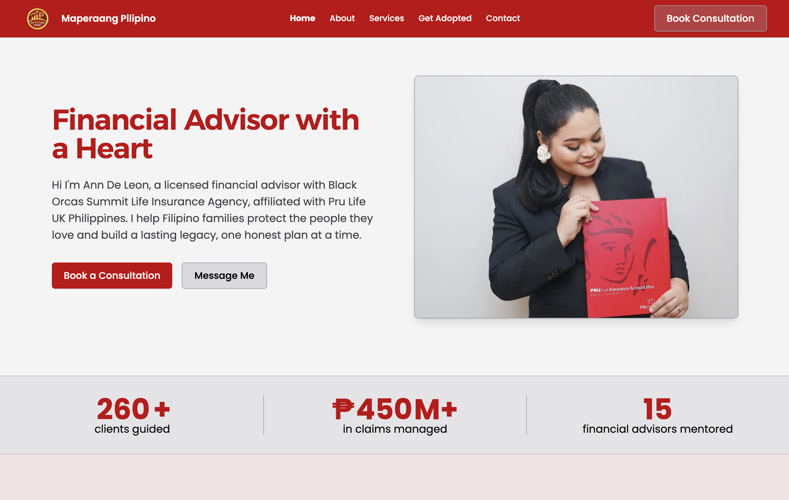

<div align="center">

  

  # Christelle Ann De Leon, CIA, CEPP
  ### Professional Portfolio & Client Advisory Portal

  **Licensed Financial Advisor & Junior Unit Manager at Pru Life UK**  
  *Showcasing career achievements, personal mission, and dedicated client advisory services.*

  [](https://astro.build/)
  [](https://www.typescriptlang.org/)
  [](https://tailwindcss.com/)
  [](https://www.docker.com/)
  [](./LICENSE)
</div>

---

##   [Live Site](http://maperaang-pilipino.vercel.app)


##### Website Snapshot



---

## Table of Contents

- [Overview](#overview)
  - [Purpose & Core Objectives](#purpose--core-objectives)
  - [Key Features](#key-features)
- [Tech Stack](#architecture--tech-stack)
  - [Project Structure](#project-structure)
  - [Technology Matrix](#technology-matrix)
- [Installation & Setup](#installation--setup)
  - [Prerequisites](#prerequisites)
  - [Quick Start](#quick-start)
- [Usage](#usage)
  - [Development Server](#development-server)
  - [Production Build](#production-build)
  - [Code Quality & Formatting](#code-quality--formatting)
  - [Running with Docker](#running-with-docker)
- [Configuration & Environment Variables](#configuration--environment-variables)
- [Contribution Guidelines](#contribution-guidelines)
- [License](#license)

---

## Overview

This repository contains the source code for the official **personal portfolio and client advisory website of Christelle Ann De Leon, CIA, CEPP** (Junior Unit Manager at Pru Life UK). 

The platform serves as an interactive professional showcase of her achievements, credentials, and mission, while offering clients and families a seamless digital gateway to connect, schedule consultations, and submit policy adoption requests.

### Purpose & Core Objectives

The platform is designed around three main client-focused pillars:

1. **Professional Showcase (Achievements, Mission & Background):**
   - Highlights Ms. Ann De Leon's professional journey and shares the guiding philosophy behind her practice.
   - Highlights her credentials and industry accolades.

2. **Streamlined Consultation & Appointment Booking:**
   - Provides a client-friendly appointment booking form for individuals, families, and business owners to request tailored financial consultations (covering protection, education, retirement, and corporate employee benefits).
   - Inquiries are processed client-side and delivered directly via automated email notifications using EmailJS.

3. **Orphan Policy Adoption Form:**
   - Offers an adoption form for Pru Policy holders whose previous financial advisors are unresponsive or inactive.
   - Enables "orphaned" clients to connect with Ms. Ann De Leon to resume active policy reviews, servicing, and claims support without administrative hassle.

### Key Features

- **Achievements & Recognition Showcase:** Responsive awards grid and timeline highlighting industry recognition and leadership milestones.
- **Streamlined Consultation Booking:** Easy to read appointment booking form for individuals, families, and business owners to request tailored financial consultations (covering protection, education, retirement, and corporate employee benefits).
- **Client Policy Adoption Intake:** Purpose-built form with guided tooltips for existing policyholders requesting policy adoption.
- **Financial Solutions Catalog:** Breakdown of Ms. Ann's offerings including personal solutions (Family Protection, Income Replacement, Critical Illness Funding, Retirement Planning, Educational Funds) and corporate solutions (Keyman Insurance, Employee Benefits).
- **Progressive Web App (PWA):** Installable web manifest and service worker, enabling clients to save the portfolio directly to their phone's home screen.
- **High-Performance Static Delivery:** Built with Astro 7 Islands Architecture, ensuring zero client-side JavaScript overhead on content pages with dynamic hydration for forms.
- **Polished UI & Micro-animations:** Powered by Starwind UI, custom typography (Alexandria & Poppins), accessible toasts, and smooth scroll animations.

---

## Architecture & Tech Stack

### Project Structure

```text
maperaang_pilipino/
├── .astro/                 # Build cache and Vite runtime artifacts
├── dist/                   # Static production output directory
├── public/                 # Public static assets
│   ├── icons/              # App icon sets and favicons
│   ├── manifest.webmanifest# Progressive Web App manifest
│   └── sw.js               # Service worker for offline caching
├── src/
│   ├── assets/             # Photography, award badges, and graphics
│   ├── components/         # Astro & React component library
│   │   ├── forms/          # Form components (AdoptionForm, Contact, etc.)
│   │   ├── hero/           # Hero section variants
│   │   ├── navbar/         # Header and mobile navigation drawer
│   │   ├── sections/       # Portfolio sections (About, Founder, Awards, Services)
│   │   ├── starwind/       # Starwind UI design system primitives
│   │   └── ui/             # General utility UI components
│   ├── config/             # Application environment and URL configuration
│   ├── layouts/            # Page templates and document wrappers (MainLayout.astro)
│   ├── pages/              # File-based routing
│   │   ├── index.astro     # Home page (Intro, Awards, Five Steps, FAQs)
│   │   ├── about.astro     # Meet Ann (Bio, Mission, Background, Credentials)
│   │   ├── services.astro  # Catalog of personal and corporate solutions
│   │   ├── consultation.astro # Individual and organizational booking portal
│   │   ├── adoption.astro  # Client policy adoption request form
│   │   └── contact.astro   # Direct contact and inquiry channels
│   ├── scripts/            # Client scripts (EmailSender.ts, ScrollAnimations.ts)
│   └── styles/             # Global stylesheets and Tailwind CSS v4 setup
├── Dockerfile              # Multi-stage production container definition
├── nginx.conf              # Nginx server configuration with stale asset fallbacks
├── astro.config.mjs        # Astro configuration with React and Tailwind Vite plugins
├── starwind.config.json    # Starwind UI component registry settings
├── tsconfig.json           # TypeScript configuration
└── package.json            # Scripts and dependency tree
```

### Technology Matrix

| Layer | Technology | Version | Purpose |
| :--- | :--- | :--- | :--- |
| **Framework** | [Astro](https://astro.build/) | `^7.2.4` | Static Site Generation (SSG) with partial hydration |
| **Styling** | [Tailwind CSS](https://tailwindcss.com/) | `^4.3.3` | Utility styling with `@tailwindcss/vite` |
| **Design System** | [Starwind UI](https://starwind.dev/) | `^1.3.0` | Accessible UI building blocks and toast notifications |
| **Form Dispatch** | [EmailJS](https://www.emailjs.com/) | `^4.4.1` | Client-side appointment and adoption form transmission |
| **Language** | [TypeScript](https://www.typescriptlang.org/) | `^6.0.3` | Strict type safety and maintainability |
| **Hosting & Container**| Docker & Nginx / Vercel | Alpine | High-efficiency containerized static hosting |

---

## Installation & Setup

### Prerequisites

Ensure the following tools are installed on your local environment:

- **Node.js**: `v20.12.0` or higher (`v22.x LTS` recommended)
- **Package Manager**: `npm` (v10+), `pnpm`, or `yarn`
- **Git**: Installed and configured
- **Docker** *(Optional)*: For containerized testing and deployment

### Quick Start

1. **Clone the repository:**
   ```bash
   git clone https://github.com/albarr15/MaperaangPilipino.git
   cd MaperaangPilipino
   ```

2. **Install project dependencies:**
   ```bash
   npm install
   ```

3. **Configure environment variables:**
   ```bash
   cp .env.example .env
   ```
   > [!NOTE]
   > Update the `.env` values if connecting custom EmailJS credentials or a distinct domain.

---

## Usage

### Development Server

Start the local Astro development server (default port `4322`):

```bash
npm run dev
```

Visit the application in your browser:
```text
http://localhost:4322
```

### Production Build

Compile the static bundle for production:

```bash
npm run build
```

The output files are generated in `./dist`.

### Local Build Preview

Preview the built static assets locally:

```bash
npm run preview
```

### Code Quality & Formatting

Format the codebase using Prettier:

```bash
npm run format
```

Run TypeScript and Astro component diagnostics:

```bash
npx astro check
```

---

### Running with Docker

A production-ready, multi-stage `Dockerfile` (`node:22-alpine` builder & `nginx:alpine` runtime) is included:

1. **Build the container image:**
   ```bash
   docker build -t ann-de-leon-portfolio:latest .
   ```

2. **Start the container:**
   ```bash
   docker run -d -p 4322:4322 --name ann-portfolio-app ann-de-leon-portfolio:latest
   ```

3. **Access the application:**
   Navigate to `http://localhost:4322`.

4. **Stop the container:**
   ```bash
   docker stop ann-portfolio-app && docker rm ann-portfolio-app
   ```

---

## Contribution Guidelines

> [!NOTE]
> This repository is a private professional portfolio for **Christelle Ann De Leon** and is maintained exclusively for authorized internal updates. It is not open for public feature contributions.

### Authorized Workflow

1. **Branching:** Work from feature branches created off `dev`:
   ```bash
   git checkout -b feat/your-feature-name
   ```
2. **Code Integrity:** Maintain existing TypeScript conventions, Starwind component patterns, and Tailwind utility standards.
3. **Pre-commit Verification:**
   ```bash
   npm run format
   npm run build
   ```
4. **Pull Requests:** Open pull requests targeting the `dev` branch for review.

---

## License

Copyright &copy; 2026 Christelle Ann De Leon. **All Rights Reserved**.

All materials contained in this repository, including source code, website copy, layout designs, and photography, are the proprietary and confidential property of the author.

Unauthorized copying, distribution, modification, reverse engineering, or commercial use without prior written authorization is strictly prohibited.